<h1 align="center">hermes-max-messenger</h1>

<p align="center">
  <b>Talk to your <a href="https://github.com/NousResearch/hermes-agent">Hermes Agent</a> in the MAX messenger</b> — the same agent, tools and memory, now in max.ru.<br>
  Plus two Russian speech-to-text providers for every Hermes platform.
</p>

<p align="center">
  <a href="LICENSE"></a>
  
  
  <a href="https://github.com/urock88/hermes-max-messenger/actions/workflows/ci.yml"></a>
  · <a href="README_RU.md">Русский</a>
</p>

<p align="center">
  <picture>
    <source media="(prefers-color-scheme: dark)" srcset="assets/architecture-dark.svg">
    
  </picture>
</p>

<p align="center"><sub>The picture plays by itself. A step-by-step interactive version is in <a href="docs/index.html"><code>docs/index.html</code></a> (open it in a browser, or enable GitHub Pages for <code>/docs</code>).</sub></p>

---

## What you get

| | |
|---|---|
| 💬 **Direct chats and groups** | Talk to Hermes one-on-one, or add the bot to a group: there it answers only when mentioned, replied to, or given a command. |
| ⌨️ **"typing…" while it thinks** | MAX shows the bot typing for as long as the agent works, and "sending a file" while an upload runs. |
| 🌊 **Streamed answers** | The reply appears at once and grows by edits, the way it does in Telegram. |
| 🎙️ **Voice notes** | Transcribed by the speech-to-text provider you choose: Yandex SpeechKit, Sber SaluteSpeech (both included), a local Whisper, or any Hermes provider. Voice replies arrive as audio. |
| 📎 **Files both ways** | Photos, videos, documents and audio in; the agent sends files back with `MEDIA:/path`. |
| 🔘 **Buttons** | Approve or deny a dangerous command, answer a clarifying question, pick a model — with native MAX buttons that only the right person can press. |
| 🔐 **Hermes pairing** | A stranger gets an access code in their own language, you hear about it in your home chat and approve it with `hermes pairing approve max <code>`; or keep a fixed list of allowed users. |
| 🧾 **Readable formatting** | The model's Markdown becomes MAX's HTML: bold, italic, code, code blocks, links, quotes, lists; tables become aligned columns or a picture. |
| ⏰ **Cron and `hermes send`** | Scheduled jobs deliver to your home chat in MAX, from inside or outside the gateway process. |
| 🖥️ **Hermes Desktop** | A "MAX sessions" page and a MAX mark on those conversations in the session list. |
| 🛡️ **Survives the real world** | The polling position is saved, redeliveries are dropped, MAX's rate limits (30 requests/s, 2 messages/s per chat) are respected, 429 and "attachment not ready" are retried. |

## Quick start (about 5 minutes)

1. **Create a bot for Hermes.** On [business.max.ru](https://business.max.ru) open *Chat bots → Create a bot* and copy the token
   (*Integration → Token*). MAX requires a verified organisation or self-employed profile to create bots.
   Use a separate bot: one token can be read by only one program.
2. **Install the plugin** on the machine where your Hermes gateway runs:
   ```bash
   hermes plugins install urock88/hermes-max-messenger --enable
   hermes gateway setup        # choose MAX, paste the token
   hermes gateway restart
   ```
3. **Say hello.** Open the bot in MAX and press *Start*. If you did not list yourself as an allowed user, the bot answers with an
   access code; approve it on the server:
   ```bash
   hermes pairing approve max <code>
   ```
4. Send `/sethome` in the chat to make it the home chat: cron results and access requests from new people go there. Done.

Voice notes need a speech-to-text provider — see [Speech-to-text](#speech-to-text).

## Letting a new person in

Each person comes in one of two ways.

**A. You know their MAX id.** Add it to `MAX_ALLOWED_USERS` (comma-separated) and run `hermes gateway restart`; they write
and get answers straight away. With a non-empty list the bot stays silent to everybody else: a stranger sees no reply, and you
see their id in the log and, once per person, in the home chat. To learn someone's id, let them go through route B once —
`hermes pairing list` shows it.

**B. An access code** — works while `MAX_ALLOWED_USERS` is empty.

| Step | The new person | You, the owner |
|---|---|---|
| 1 | Finds the bot in MAX (by its name or a link you send) and presses *Start* or writes anything. | — |
| 2 | Gets a message with an access code, in their MAX app's language (Russian or English; otherwise `MAX_LANGUAGE`). | If a home chat is set, the bot tells you at once: name, MAX id, code and the command to run. |
| 3 | Forwards that message to you, through any messenger. | Runs `hermes pairing approve max <code>` on the server where Hermes runs. |
| 4 | Gets "You're approved ✅" within about 15 seconds and just writes. | — |

A code lives one hour, and a person gets at most one code per 10 minutes; if they write again meanwhile, the bot reminds them
of the same code. Don't know the person? Do nothing: the code expires. To take access back: `hermes pairing revoke max <id>`.
Approve only people you trust — an approved person can ask the agent to do anything it can do.

## Next to the Telegram adapter

| Feature | Telegram (built in) | MAX (this plugin) |
|---|:---:|:---:|
| Direct chats, groups with mention gating | ✅ | ✅ |
| Typing indicator while the agent works | ✅ | ✅ |
| Streamed replies by editing | ✅ | ✅ |
| Voice in (speech-to-text) / voice replies | ✅ / ✅ | ✅ / ✅ (as audio) |
| Photos, video, documents in and out | ✅ | ✅ |
| Approval, clarify and model-picker buttons | ✅ | ✅ |
| Slash-command confirmations as buttons | ✅ | text (`/approve`, `/cancel`) |
| Reactions as a status (👀 → 👍) | ✅ | — (MAX bots have no reactions) |
| Command menu | ✅ | ✅ (13 everyday commands) |
| Pairing codes, allowlists, cron delivery | ✅ | ✅ |
| Long polling and webhook | ✅ | ✅ |

## Settings

Environment variables go to `~/.hermes/.env` (or are asked by `hermes gateway setup`); the same keys without the `MAX_`
prefix can be set under `platforms.max.extra` in `config.yaml`. Environment wins.

| Variable | Default | Meaning |
|---|---|---|
| `MAX_BOT_TOKEN` | — | **Required.** The bot's token. |
| `MAX_ALLOWED_USERS` | empty | Comma-separated MAX user ids allowed to use the bot. Empty: strangers get a pairing code. |
| `MAX_ALLOW_ALL_USERS` | `false` | Let anyone who writes to the bot use it (and your server). Not recommended. |
| `MAX_HOME_CHANNEL` | empty | Where cron results and access requests go: a user id, or a group chat id (negative). `/sethome` sets it too. |
| `MAX_GROUP_ALLOWED_CHATS` | empty | Group chat ids where any member may use the bot. |
| `MAX_REQUIRE_MENTION` | `true` | In groups, answer only when mentioned, replied to, or given a command. |
| `MAX_FREE_RESPONSE_CHATS` | empty | Group chat ids where every message counts, mention or not. |
| `MAX_LANGUAGE` | `ru` | Language of the plugin's own words (buttons, command menu, notices to you, start-up errors): `ru` or `en`. A new person is answered in their MAX app's language when it is one of these two. |
| `MAX_WEBHOOK_URL` | empty | Public `https://` URL (port 443). Set it to use a webhook instead of long polling. |
| `MAX_WEBHOOK_SECRET` | — | Required with a webhook: 5–256 characters of `A-Z a-z 0-9 _ -`. |
| `MAX_WEBHOOK_HOST` | `127.0.0.1` | Local address the webhook listener binds to. |
| `MAX_WEBHOOK_PORT` | `8646` | Local port of the webhook listener (behind your reverse proxy). |
| `MAX_WEBHOOK_PATH` | `/max/webhook` | Path of the webhook listener. |
| `MAX_POLLING_TAKEOVER` | `false` | Long polling only: remove the bot's webhook subscriptions at start (otherwise the adapter refuses to start and says why). |
| `MAX_TABLE_AS_IMAGE` | `false` | Send Markdown tables as PNG pictures (needs Pillow and a monospace font such as DejaVu Sans Mono). |
| `MAX_TABLE_FONT` | auto | Path to the TrueType font for table pictures. |
| `MAX_UPDATE_COMMANDS` | `true` | Publish the command menu (`/new`, `/model`, `/status` …) when the gateway starts. |
| `MAX_API_BASE` | `https://platform-api2.max.ru` | MAX Bot API address. |

## Speech-to-text

Hermes transcribes voice notes with the provider named in `stt.provider` — for **every** platform, not only MAX. This plugin
adds two cloud providers used in Russia; Hermes already has `local` (faster-whisper, offline), `local_command` (any command,
e.g. whisper.cpp or Vosk), `groq`, `openai`, `mistral`, `xai`, `elevenlabs` and `deepinfra`.

| Provider | `stt.provider` | Needs | Notes |
|---|---|---|---|
| Yandex SpeechKit | `yandex_speechkit` | `YANDEX_SPEECHKIT_API_KEY` (+ `YANDEX_SPEECHKIT_FOLDER_ID` for a user-account key) | API key of a service account with the `ai.speechkit-stt.user` role. Billed per 15 s. |
| Sber SaluteSpeech | `sber_salutespeech` | `SALUTESPEECH_AUTH_KEY`, optional `SALUTESPEECH_SCOPE` | Authorization key of a SaluteSpeech project. Since July 2026 only legal entities and self-employed can buy packages; a personal key answers HTTP 402. |
| Local Whisper | `local` | — | Built into Hermes. Needs RAM/CPU (or a GPU): too heavy for a 1 GB server. |

```yaml
# ~/.hermes/config.yaml
stt:
  provider: yandex_speechkit
  yandex_speechkit:
    language: ru        # ru, en, kk, uz, tr … or a full code like ru-RU
```

Long recordings are cut by `ffmpeg` into 29-second pieces recognised three at a time (up to 10 minutes). Install `ffmpeg` on
the server (`apt install ffmpeg`); without it only short OGG/Opus voice notes work. `FFMPEG_PATH` points to a non-standard binary.
How to plug in another recognizer: [docs/stt.md](docs/stt.md).

## Long polling or webhook

**Long polling** (default) needs nothing public: the gateway asks MAX for updates. MAX allows one reader per bot and no
polling while a webhook subscription exists — the adapter checks and tells you.

**Webhook** suits a server with a domain. MAX posts to `https://` on port 443 with a certificate from a trusted CA and gives
up on a subscription after 8 hours of failures. Put the listener behind your reverse proxy:

```nginx
location = /max/webhook {
    proxy_pass http://127.0.0.1:8646/max/webhook;
    client_max_body_size 1m;
}
```

```bash
MAX_WEBHOOK_URL=https://bot.example.org/max/webhook
MAX_WEBHOOK_SECRET=$(openssl rand -hex 24)
```

## Groups

Add the bot to a group and make it an **administrator** — MAX sends group messages to bots that are admins only. By default the
bot answers when someone mentions it, replies to its message or sends a command. Who may use it there is decided by Hermes:
people in `MAX_ALLOWED_USERS`, or anyone in a chat listed in `MAX_GROUP_ALLOWED_CHATS`.

## Security model

* **Nothing is fetched for strangers.** Attachments of a person who is not allowed (yet) are never downloaded; they only get a pairing code.
* **Hermes decides who gets in.** The plugin only rewords core's pairing reply into the person's language, reminds them of
  the same code and tells you about the request; minting, rate-limiting and approving codes stay in Hermes core.
* **Downloads are SSRF-safe.** Hermes' own client checks every address and redirect; the bot token is never sent to media hosts.
* **Buttons are bound to their owner.** A prompt remembers who raised it, in which chat and on which message, and expires in
  15 minutes. Anyone else's press is refused and does not use the prompt up.
* **Webhook secrets** are checked in constant time before the body is read; without a secret the webhook does not start.
* **TLS stays on.** `platform-api2.max.ru` uses the Russian Trusted Root CA; the plugin adds that one public root (shipped in
  `assets/certs`) to the standard ones instead of switching verification off.
* **No message text in logs**, no telemetry, no self-update.

## Limitations

* MAX bots cannot write first: a person must open the bot once.
* Editing a message you already sent does not start a new turn.
* MAX bots have no message reactions, so there is no 👀/👍 status.
* Slash-command confirmations (`/reload-mcp` …) are answered with `/approve` / `/cancel`, not buttons.
* Do not install it together with another MAX plugin (`max-platform`): both register the `max` platform.

## Network and disk disclosure

The plugin talks to `platform-api2.max.ru` (the bot token goes there in a header) and to MAX's upload and media hosts
(`*.max.ru`, `*.oneme.ru`, `*.okcdn.ru`). The speech-to-text providers, when selected, send audio to
`stt.api.cloud.yandex.net` or `smartspeech.sber.ru` / `ngw.devices.sberbank.ru`. In webhook mode it listens on
`127.0.0.1:8646`. It keeps a small SQLite file under `<HERMES_HOME>/plugin-data/max-messenger/`.

## Development

```bash
(cd /path/to/hermes-agent && uv sync --frozen)    # Hermes core, Python 3.14 (pip cannot resolve its pins)
uv pip install --python /path/to/hermes-agent/.venv/bin/python -r pyproject.toml --extra dev --extra tables
export PYTHONPATH=/path/to/hermes-agent              # then use that venv's python, pytest and ruff
pytest -q && ruff check .
python scripts/check_config_reference.py            # the settings table above matches the code
python scripts/build_architecture_svg.py            # rebuild the README picture
```

Tests run the adapter against the real Hermes core and a scripted fake of the MAX API. A checklist for a test with a live bot
is in [docs/setup.md](docs/setup.md).

## Credits and license

MIT — see [LICENSE](LICENSE). Written from scratch; it learned from the earlier MAX plugins
[Realmagnum/hermes-max-integration](https://github.com/Realmagnum/hermes-max-integration) and
[vladimiraldushin/hermes-max-platform](https://github.com/vladimiraldushin/hermes-max-platform) (both MIT) — see [NOTICE](NOTICE).
