<h1 align="center">hermes-max-messenger</h1>

<p align="center">
  <b>Общайтесь со своим <a href="https://github.com/NousResearch/hermes-agent">Hermes Agent</a> в мессенджере MAX</b> — тот же агент, инструменты и память, теперь в max.ru.<br>
  И два российских сервиса расшифровки голоса для всех платформ Hermes.
</p>

<p align="center">
  <a href="LICENSE"></a>
  
  
  <a href="https://github.com/urock88/hermes-max-messenger/actions/workflows/ci.yml"></a>
  · <a href="README.md">English</a>
</p>

<p align="center">
  <picture>
    <source media="(prefers-color-scheme: dark)" srcset="assets/architecture-dark.svg">
    
  </picture>
</p>

<p align="center"><sub>Схема анимируется сама. Интерактивная версия по шагам — <a href="docs/index.html"><code>docs/index.html</code></a> (откройте в браузере или включите GitHub Pages для <code>/docs</code>).</sub></p>

---

## Что умеет

| | |
|---|---|
| 💬 **Личка и группы** | Пишите Hermes напрямую или добавьте бота в группу: там он отвечает только на упоминание, ответ на своё сообщение или команду. |
| ⌨️ **«печатает…», пока думает** | MAX показывает, что бот печатает, всё время, пока агент работает, и «отправляет файл» во время загрузки. |
| 🌊 **Постепенный вывод** | Ответ появляется сразу и дописывается правками, как в Telegram. |
| 🎙️ **Голосовые** | Расшифровываются выбранным провайдером: Yandex SpeechKit, Сбер SaluteSpeech (оба в комплекте), локальный Whisper или любой провайдер Hermes. Голосовые ответы приходят аудио. |
| 📎 **Файлы в обе стороны** | Фото, видео, документы и аудио на вход; агент отправляет файлы через `MEDIA:/path`. |
| 🔘 **Кнопки** | Разрешить или запретить опасную команду, ответить на уточняющий вопрос, выбрать модель — родными кнопками MAX, которые может нажать только тот, кому они адресованы. |
| 🔐 **Pairing Hermes** | Незнакомец получает код, который вы одобряете командой `hermes pairing approve max <код>`; или задайте постоянный список пользователей. |
| 🧾 **Читаемое оформление** | Markdown модели превращается в HTML MAX: жирный, курсив, код, блоки кода, ссылки, цитаты, списки; таблицы — ровными столбцами или картинкой. |
| ⏰ **Cron и `hermes send`** | Задачи по расписанию доставляются в домашний чат MAX — изнутри процесса шлюза и снаружи. |
| 🖥️ **Hermes Desktop** | Страница «Сессии MAX» и пометка MAX у таких разговоров в списке сессий. |
| 🛡️ **Живучесть** | Позиция опроса сохраняется, повторные доставки отбрасываются, ограничения MAX (30 запросов/с, 2 сообщения/с на чат) соблюдаются, 429 и «вложение не готово» повторяются. |

## Запуск примерно за 5 минут

1. **Создайте бота для Hermes.** На [business.max.ru](https://business.max.ru) откройте *Чат-боты → Создать бота* и скопируйте
   токен (*Интеграция → Токен*). Для создания ботов MAX требует подтверждённый профиль организации или самозанятого.
   Используйте отдельного бота: один токен может читать только одна программа.
2. **Установите плагин** на машине, где работает шлюз Hermes:
   ```bash
   hermes plugins install urock88/hermes-max-messenger --enable
   hermes gateway setup        # выберите MAX, вставьте токен
   hermes gateway restart
   ```
3. **Поздоровайтесь.** Откройте бота в MAX и нажмите *Начать*. Если вы не указали себя в разрешённых пользователях, бот
   ответит кодом pairing; одобрите его на сервере:
   ```bash
   hermes pairing approve max <код>
   ```
4. Отправьте в чат `/sethome`, чтобы результаты cron приходили сюда. Готово.

Для голосовых нужен провайдер расшифровки — см. [Расшифровка голоса](#расшифровка-голоса).

## Рядом с адаптером Telegram

| Возможность | Telegram (встроен) | MAX (этот плагин) |
|---|:---:|:---:|
| Личка, группы с ответом по упоминанию | ✅ | ✅ |
| Индикатор печати, пока агент работает | ✅ | ✅ |
| Постепенный вывод правками | ✅ | ✅ |
| Голос на вход (расшифровка) / голосовые ответы | ✅ / ✅ | ✅ / ✅ (аудио) |
| Фото, видео, документы в обе стороны | ✅ | ✅ |
| Кнопки подтверждения, уточнения, выбора модели | ✅ | ✅ |
| Подтверждение slash-команд кнопками | ✅ | текстом (`/approve`, `/cancel`) |
| Реакции как статус (👀 → 👍) | ✅ | — (у ботов MAX нет реакций) |
| Меню команд | ✅ | ✅ (13 повседневных команд) |
| Коды pairing, списки доступа, доставка cron | ✅ | ✅ |
| Long polling и webhook | ✅ | ✅ |

## Настройки

Переменные окружения кладутся в `~/.hermes/.env` (или их спрашивает `hermes gateway setup`); те же ключи без префикса
`MAX_` можно задать в `platforms.max.extra` файла `config.yaml`. Переменная окружения важнее.

| Переменная | По умолчанию | Смысл |
|---|---|---|
| `MAX_BOT_TOKEN` | — | **Обязательна.** Токен бота. |
| `MAX_ALLOWED_USERS` | пусто | Id пользователей MAX через запятую, которым можно пользоваться ботом. Пусто — незнакомцы получают код pairing. |
| `MAX_ALLOW_ALL_USERS` | `false` | Пустить всех, кто напишет боту (и тем самым на ваш сервер). Не рекомендуется. |
| `MAX_HOME_CHANNEL` | пусто | Куда идут результаты cron: id пользователя или группового чата (отрицательный). Его же задаёт `/sethome`. |
| `MAX_GROUP_ALLOWED_CHATS` | пусто | Id групп, где ботом может пользоваться любой участник. |
| `MAX_REQUIRE_MENTION` | `true` | В группах отвечать только на упоминание, ответ на сообщение бота или команду. |
| `MAX_FREE_RESPONSE_CHATS` | пусто | Id групп, где учитывается каждое сообщение, с упоминанием или без. |
| `MAX_LANGUAGE` | `ru` | Язык собственных слов плагина (кнопки, меню команд): `ru` или `en`. |
| `MAX_WEBHOOK_URL` | пусто | Публичный адрес `https://` (порт 443). Задайте, чтобы получать события по webhook вместо long polling. |
| `MAX_WEBHOOK_SECRET` | — | Обязателен для webhook: 5–256 символов из `A-Z a-z 0-9 _ -`. |
| `MAX_WEBHOOK_HOST` | `127.0.0.1` | Локальный адрес, который слушает приёмник webhook. |
| `MAX_WEBHOOK_PORT` | `8646` | Локальный порт приёмника webhook (за вашим обратным прокси). |
| `MAX_WEBHOOK_PATH` | `/max/webhook` | Путь приёмника webhook. |
| `MAX_POLLING_TAKEOVER` | `false` | Только для long polling: снять webhook-подписки бота при старте (иначе адаптер не запустится и скажет почему). |
| `MAX_TABLE_AS_IMAGE` | `false` | Отправлять таблицы Markdown картинками PNG (нужны Pillow и моноширинный шрифт, например DejaVu Sans Mono). |
| `MAX_TABLE_FONT` | авто | Путь к шрифту TrueType для картинок таблиц. |
| `MAX_UPDATE_COMMANDS` | `true` | Публиковать меню команд (`/new`, `/model`, `/status` …) при запуске шлюза. |
| `MAX_API_BASE` | `https://platform-api2.max.ru` | Адрес MAX Bot API. |

## Расшифровка голоса

Hermes расшифровывает голосовые провайдером, указанным в `stt.provider`, — для **всех** платформ, не только MAX. Плагин
добавляет два облачных провайдера, распространённых в России; в самом Hermes уже есть `local` (faster-whisper, без сети),
`local_command` (любая команда, например whisper.cpp или Vosk), `groq`, `openai`, `mistral`, `xai`, `elevenlabs` и `deepinfra`.

| Провайдер | `stt.provider` | Нужно | Заметки |
|---|---|---|---|
| Yandex SpeechKit | `yandex_speechkit` | `YANDEX_SPEECHKIT_API_KEY` (+ `YANDEX_SPEECHKIT_FOLDER_ID` для ключа пользовательского аккаунта) | API-ключ сервисного аккаунта с ролью `ai.speechkit-stt.user`. Оплата за каждые 15 с. |
| Сбер SaluteSpeech | `sber_salutespeech` | `SALUTESPEECH_AUTH_KEY`, по желанию `SALUTESPEECH_SCOPE` | Ключ авторизации проекта SaluteSpeech. С июля 2026 пакеты покупают только юрлица и самозанятые; ключ физлица отвечает HTTP 402. |
| Локальный Whisper | `local` | — | Встроен в Hermes. Нужны память и процессор (или видеокарта): тяжело для сервера с 1 ГБ. |

```yaml
# ~/.hermes/config.yaml
stt:
  provider: yandex_speechkit
  yandex_speechkit:
    language: ru        # ru, en, kk, uz, tr … или полный код вроде ru-RU
```

Длинные записи режутся `ffmpeg` на куски по 29 секунд и распознаются по три одновременно (до 10 минут). Установите `ffmpeg`
на сервер (`apt install ffmpeg`); без него работают только короткие голосовые OGG/Opus. `FFMPEG_PATH` указывает на
нестандартный путь к программе. Как подключить другой распознаватель: [docs/stt.md](docs/stt.md).

## Long polling или webhook

**Long polling** (по умолчанию) не требует ничего публичного: шлюз сам спрашивает MAX об обновлениях. MAX допускает одного
читателя на бота и не отдаёт обновления опросом, пока есть webhook-подписка, — адаптер это проверяет и сообщает.

**Webhook** подходит серверу с доменом. MAX отправляет события на `https://` порт 443 с сертификатом доверенного центра и
снимает подписку после 8 часов неудач. Поставьте приёмник за обратный прокси:

```nginx
location = /max/webhook {
    proxy_pass http://127.0.0.1:8646/max/webhook;
    client_max_body_size 1m;
}
```

```bash
MAX_WEBHOOK_URL=https://bot.example.org/max/webhook
MAX_WEBHOOK_SECRET=$(openssl rand -hex 24)
```

## Группы

Добавьте бота в группу и сделайте его **администратором** — MAX передаёт ботам сообщения группы, только если они
администраторы. По умолчанию бот отвечает, когда его упоминают, отвечают на его сообщение или отправляют команду. Кому можно
им пользоваться, решает Hermes: людям из `MAX_ALLOWED_USERS` или всем в чатах из `MAX_GROUP_ALLOWED_CHATS`.

## Модель безопасности

* **Для незнакомцев ничего не скачивается.** Вложения человека, которому (пока) нельзя, не загружаются никогда; он получает только код pairing.
* **Загрузки защищены от подмены адресов (SSRF).** Собственный клиент Hermes проверяет каждый адрес и перенаправление; токен бота на хосты медиа не уходит.
* **Кнопки привязаны к владельцу.** Запрос помнит, кто его вызвал, в каком чате и на каком сообщении, и истекает через
  15 минут. Нажатие кого-то другого отклоняется и не расходует запрос.
* **Секрет webhook** сверяется за постоянное время до чтения тела; без секрета webhook не запускается.
* **TLS не отключается.** `platform-api2.max.ru` подписан Russian Trusted Root CA; плагин добавляет этот один публичный
  корень (лежит в `assets/certs`) к стандартным, а не выключает проверку.
* **Текст сообщений не пишется в логи**, нет телеметрии, нет самообновления.

## Ограничения

* Бот MAX не может написать первым: человек должен один раз открыть бота.
* Правка уже отправленного сообщения не запускает новый ход.
* У ботов MAX нет реакций на сообщения, поэтому статуса 👀/👍 нет.
* Подтверждения slash-команд (`/reload-mcp` …) принимаются текстом `/approve` / `/cancel`, а не кнопками.
* Не ставьте вместе с другим плагином MAX (`max-platform`): оба регистрируют платформу `max`.

## Какие обращения в сеть и на диск

Плагин обращается к `platform-api2.max.ru` (туда уходит токен бота в заголовке) и к хостам загрузки и медиа MAX
(`*.max.ru`, `*.oneme.ru`, `*.okcdn.ru`). Провайдеры расшифровки, если выбраны, отправляют аудио на
`stt.api.cloud.yandex.net` или `smartspeech.sber.ru` / `ngw.devices.sberbank.ru`. В режиме webhook плагин слушает
`127.0.0.1:8646`. Он хранит небольшой файл SQLite в `<HERMES_HOME>/plugin-data/max-messenger/`.

## Разработка

```bash
python -m pip install -e /path/to/hermes-agent     # ядро Hermes, Python 3.14
python -m pip install -e ".[dev,tables]"
pytest -q && ruff check .
python scripts/check_config_reference.py            # таблица настроек совпадает с кодом
python scripts/build_architecture_svg.py            # пересобрать картинку README
```

Тесты гоняют адаптер против настоящего ядра Hermes и сценарной имитации MAX API. Чек-лист проверки на живом боте —
в [docs/setup.md](docs/setup.md).

## Авторы и лицензия

MIT — см. [LICENSE](LICENSE). Написан с нуля; учился на ранних плагинах MAX
[Realmagnum/hermes-max-integration](https://github.com/Realmagnum/hermes-max-integration) и
[vladimiraldushin/hermes-max-platform](https://github.com/vladimiraldushin/hermes-max-platform) (оба MIT) — см. [NOTICE](NOTICE).
